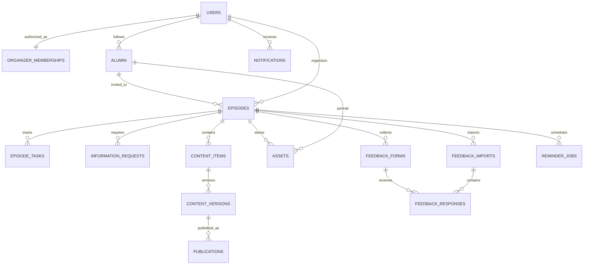

# 08 — Modèle de données, relations et contraintes

> **Projet :** Voix d’Alumni Studio · **Édition :** 21 octobre 2026 · **Statut :** Spécification initiale à valider lors du lot 0
> **Objet :** Donner les entités métier et les invariants de persistance pour PostgreSQL et Drizzle.
> **Référence UX :** `Docs/voix_alumni_studio_prototype.html` (maquette de démonstration validée ; ne pas la modifier automatiquement).

## Principes généraux

- Identifiants UUID serveur pour les objets métier ; les clés des tables Better Auth gardent le type exigé par sa configuration épinglée. Les FK d'acteur reprennent exactement ce type. `created_at`, `updated_at`, `created_by` et version de concurrence (entier) sur objets éditables.
- Métadonnées de suivi et d'audit séparées des documents sensibles ; suppression logique pour objets métier liés à des archives et rétention explicite pour données personnelles.
- Index et contraintes DB, pas seulement validations React.
- `Alumni` représente une personne ; `Episode` représente une session ; `EpisodeSpeaker` permet éventuellement de futurs épisodes multi-intervenants, **sans compliquer la V1 si un seul speaker par épisode suffit**.

## 1. Entités cœur

### Identités Better Auth et `organizer_memberships`

Better Auth détient ses tables `user`, `session`, `account` et `verification`, générées selon la version épinglée puis intégrées aux migrations Drizzle. Ne pas créer une seconde table de comptes avec mots de passe concurrents. `organizer_memberships` est une table métier distincte, provisionnée en privé ; une session Better Auth ne suffit pas à autoriser l'accès aux dossiers.

| Champ | Type | Contraintes |
|---|---|---|
| `user_id` | ID Better Auth | PK/FK vers `user.id` ; ne pas supposer UUID sans configuration explicite |
| `role` | enum métier | `RESPONSABLE`, `PRODUCTION`, attribué seulement par bootstrap privé |
| `active`, `authorized_at`, `revoked_at` | bool/timestamptz | vérifiés côté Hono à chaque accès protégé |
| `authorized_by`, `provisioning_ref` | ID/note | audit du provisionnement |

Email, identité Google et hash du mot de passe relèvent des tables Better Auth. La liste des personnes autorisées doit précéder leur première connexion ; une adresse Google vérifiée ne crée pas une autorisation métier. Le schéma exact de Better Auth est figé avec la version installée et revu avant migration.

### `alumni`

| Champ | Type | Contraintes / remarques |
|---|---|---|
| `id` | UUID | PK |
| `full_name` | text | obligatoire, non vide |
| `promotion_year` | smallint ou text | année validée ; `null` autorisé au brouillon |
| `job_title`, `company`, `biography` | text | source et date de vérification recommandées |
| `linkedin_url` | text | URL optionnelle, jamais autorisation de scraping |
| `relation_status` | enum | voir doc 02 |
| `contact_notes` | text | interne et potentiellement sensible |
| `lead_user_id` | FK vers `user.id` | Responsable de la relation |
| `profile_photo_asset_id` | UUID FK assets | nullable |
| `archived_at`, `source_ref` | datetime/text | trace provenance |

**Coordonnées** (`email`, `phone`) : éviter de les collecter pour le MVP si inutile à Production ; si retenues, table séparée avec accès limité à Responsable, audit et chiffrement adapté au risque.

### `episodes`

| Champ | Type | Contraintes |
|---|---|---|
| `id` | UUID | PK |
| `public_number` | integer nullable | unique si attribué ; à figer à la confirmation selon règle métier |
| `alumni_id` | UUID FK | une personne pour V1 |
| `title`, `topic` | text | optionnels/progressifs |
| `status` | enum | machine du doc 02 |
| `start_at_utc` | timestamptz nullable | requis en état confirmé |
| `event_timezone` | text | identifiant IANA validé |
| `start_time_label_override` | text nullable | interdit comme source temporelle ; sert seulement si annotation éditoriale |
| `schedule_version` | integer | incrément au report |
| `lead_user_id`, `production_user_id` | FK vers `user.id` | rôles assignés |
| `handed_off_at`, `confirmed_at`, `held_at`, `closed_at` | timestamptz | transitions explicites |
| `meeting_url`, `feedback_url`, `youtube_url` | URL nullable | validées et non présumées actives |
| `recording_rights_status` | enum | autorisé/à_confirmer/refusé |
| `version`, `archived_at` | integer/datetime | concurrence/conservation |

**Important :** l'état « session passée » de la maquette ne suffit pas pour définir `held_at` ; date antérieure et réalisation confirmée sont deux faits différents.

### `task_definitions`, `episode_tasks`

- `task_definitions`: `key`, `stage_index(1..8)`, `title`, `default_owner_role`, `required`, `relative_due_rule`, `template_version`, `active`.
- `episode_tasks`: `id`, `episode_id`, `definition_key`, `owner_user_id`, `status`, `due_at_utc`, `completed_by`, `completed_at`, `proof_asset_id`, `comment`, `blocked_reason`, `version`.
- Unique `(episode_id, definition_key, template_version)` ; les tâches sont **snapshottées** à la création pour éviter qu'un changement de modèle ne réécrive les archives.

### `information_requests`

`id`, `episode_id`, `requested_by_id`, `assigned_to_id` (**toujours la Responsable pour demandes concernant l'alumni**), `subject`, `questions_json` ou table `request_items`, `status`, `response_text`, `responded_by/at`, `resolved_by/at`, `due_at`, `version`.

**Invariant serveur :** `assigned_to_id = episode.lead_user_id` sur demande concernant l'alumni ; aucun champ `external_recipient`.

### `content_items` et `content_versions`

- `content_items`: `id`, `episode_id`, `type` (`announcement`, `reminder`, `thanks_immediate`, `thanks_final`, `replay_message`, `poster_announcement`, `poster_thanks`, `interview_script`), `status`, `current_version_id`.
- `content_versions`: `id`, `content_item_id`, `version_no`, `template_key/version`, `body`, `variables_snapshot_json`, `asset_id nullable`, `created_by/at`, `approved_by/at`, `approval_invalidated_at`, `content_hash`.
- Une version publiée reste figée ; une modification crée une nouvelle version, avec nouvelle validation.

### `publications`

`id`, `episode_id`, `content_version_id`, `channel` (`whatsapp_community`, `whatsapp_group`, `email`, `other`), `status`, `planned_at`, `confirmed_at`, `confirmed_by`, `external_url`, `proof_asset_id`, `correction_of_id nullable`.

**Invariant :** publication constatée possible seulement pour une version validée ; `copied_at` et `exported_at` ne créent **jamais** `confirmed_at`.

### `assets`

`id`, `episode_id nullable`, `alumni_id nullable`, `kind`, `storage_key`, `storage_provider`, `bucket_scope` (`dev`/`prod`), `original_filename`, `mime_type`, `byte_size`, `sha256`, `uploaded_by/at`, `rights_status`, `rights_basis_note`, `deleted_at nullable`, `version`. Les clés d'objet restent opaques et les URLs signées ne sont pas persistées.

Types : portrait, logo, affiche, transcript, recording_reference, feedback_import, document. Les liens YouTube sont des références de médias externes, sans upload forcé de la vidéo dans le VPS.

`media_consents` : `id`, `subject_id/episode_id`, `asset_id nullable`, `purpose` (`portrait_announcement`, `recording`, `replay`, `quote`, etc.), `status` (`unknown/requested/granted/refused/revoked`), `scope`, `evidence_ref`, `recorded_by/at`, `revoked_at`. Un consentement pour une finalité ne vaut pas accord universel ; le retrait invalide les nouveaux accès/publications concernés.

### `interview_questions`

`id`, `episode_id nullable` (null = bibliothèque générique), `category`, `body`, `sort_order`, `priority`, `source_note`, `created_by`. Pour un épisode : snapshot indépendant de la bibliothèque.

### `feedback_forms`, `feedback_questions`, `feedback_responses`, `feedback_imports`

- Formulaire natif V1 : `episode_id`, version de questions, statut `draft/open/closed`, jeton public opaque stocké sous forme de hash, ouverture/fermeture et consentement/version de notice. Questions ordonnées et typées, sans collecte d'identité obligatoire.
- Réponses natives : `form_id`, `submitted_at`, données validées minimisées, consentement/notice référencés, source `native` ; ni `user_id` organisateur ni contact alumni créé. Anonymes par défaut, identité collectée seulement si la question est explicitement activée. Prévoir `deleted_at` ou suppression contrôlée des réponses individuelles et politique de rétention configurable par formulaire.
- Import : `file_checksum`, `episode_id`, `uploaded_at`, `mapping_version`, `raw_count`, `accepted_count`, `rejected_count` ; unique `(episode_id, file_checksum)` par défaut.
- Réponses importées : `source=historical_import`, `import_id`, empreinte de ligne ou identifiant source, date et valeurs acceptées ; pas de numéros de téléphone obligatoires pour donner son avis.
- Les agrégats conservés après suppression de réponses individuelles doivent être réellement anonymisés, sans cellule ou combinaison permettant de retrouver une personne.

### `notifications`, `reminder_jobs`, `audit_events`

- Notification interne : `recipient_user_id`, `event_type`, `resource_type/id`, `read_at`, `created_at` ; pas d'email externe dans V1.
- Job : `idempotency_key`, `episode_id`, `schedule_version`, `due_at`, `executed_at`, `status`, `attempts`, `last_error_redacted`.
- Audit append-only : `actor_user_id`, `action`, `entity_type/id`, `occurred_at`, `changes_redacted_json`, `request_id`.

## 2. Diagramme de relations

## 3. Contraintes et index essentiels

- Unique `users.email`; `episodes.public_number` unique si not null ; `(episode_id, task definition)` unique ; checksum import.
- Index sur `episodes(start_at_utc,status)`, `episode_tasks(owner_user_id,status,due_at_utc)`, `information_requests(assigned_to_id,status)`, `publications(episode_id,status)`, `notifications(recipient_user_id,read_at)`.
- FKs restrictives sur historiques, pas de `ON DELETE CASCADE` généralisé vers audits/publications.
- Contrainte par service transactionnel : `approved` => validateur enregistré ; `published` => auteur, date, canal et version ; `held_at` seulement si statut réalisé ou ultérieur.
- Check sur le format MIME/size au service fichiers ; bloquer les chemins relatifs / traversées.

## 4. Concurrence et migrations

Utiliser `version` et `expected_version` sur mutations concurrentes ; renvoyer `409 Conflict` avec l'état actuel si divergence. Migrations numérotées, réversibles si possible ; migration destructive conditionnée à sauvegarde et approbation. Ne pas migrer le Google Sheets directement sans aperçu/idempotence.

## 5. Frontière de confidentialité et rétention

Conserver le minimum d'informations de contact, les réponses de feedback anonymisées dès que possible, logs sans PII, métadonnées de consentement photo/vidéo, suppression ciblée selon règles légales/organisationnelles **à valider avant prod**. Ni la présence d'un portrait dans WhatsApp ni une publication LinkedIn ne vaut automatiquement accord pour une nouvelle affiche.

Références : [workflow](02_WORKFLOWS_ET_REGLES_METIER.md) · [API](09_CONTRATS_API.md) · [sécurité](13_SECURITE_ET_CONFIDENTIALITE.md).
