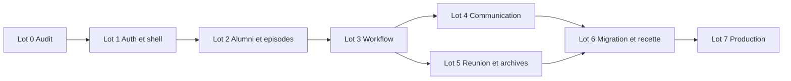

# 12 — Plan d’implémentation par lots, portes et livrables

> **Projet :** Voix d’Alumni Studio · **Édition :** 21 octobre 2026 · **Statut :** Spécification initiale à valider lors du lot 0
> **Objet :** Orchestrer le développement de l’audit jusqu’à la première session officielle.
> **Référence UX :** `Docs/voix_alumni_studio_prototype.html` (maquette de démonstration validée ; ne pas la modifier automatiquement).

## Règles du plan

- Avancer **lot par lot** ; chaque lot est une **tranche verticale démontrable**, non 100 % du backend puis 100 % du frontend.
- Ne jamais déclarer « prêt » sans tests et preuve de persistance/auth/permissions applicables.
- Les fonctionnalités V2/V3 sont étudiées séparément ; le MVP ne dépend pas d'OAuth Teams ou de publication WhatsApp automatisée.
- Fin de lot : rapport conforme au gabarit `AGENTS.md`, diff inspectable, démonstration et validation humaine avant lot suivant.
- La maquette HTML validée est une référence : aucune refonte cosmétique autonome.

## Lot 0 — Audit et fondations

**Entrée :** dépôt existant, maquette en `Docs/`, documents présents, accès dev.
**Travaux :** audit lecture seule (`git status`, code, dépendances, serveur), inventaire ports/réseaux sans modification, correction des documents selon la stack TypeScript et les décisions R2/auth/feedback validées ; structure monorepo, `.gitignore`, `.env.example`, dépendances verrouillées, PostgreSQL local isolé, scripts et lint/tests de base. L'initialisation locale a été autorisée explicitement le 21/10/2026 ; aucun bucket R2 ni identifiant externe n'est créé.
**Sortie :** backend/frontend minimaux en local avec `/api/health` et readiness PostgreSQL, docs et commandes réelles, aucun changement prod. Auth, rôles, modèles métier, studio et feedback fonctionnels appartiennent aux lots suivants.
**Tests :** smoke local, lint, build, inventaire Git.
**Porte :** validation du socle Lot 0 testé ; hébergement, domaine, buckets R2 et Google OAuth réels *non encore provisionnés*. Le Lot 1 exige une autorisation explicite séparée.

## Lot 1 — Socle utilisable et design

**Travaux :** base PostgreSQL isolée, migrations Drizzle et Better Auth, provisionnement privé de deux comptes autorisés, email/mot de passe et Google OAuth sans inscription publique, login/logout/recovery, shell desktop/mobile fidèle à la maquette, navigation, logs/audit, endpoints santé.
**Scénario :** Responsable connectée voit tableau de bord vide ; Production connectée voit sa vue ; visiteur anonyme est bloqué.
**Tests :** refus des inscriptions email et OAuth, liaison Google sûre, compte révoqué, 401/403, CSRF/cookies, browser mobile/desktop, persistance après redémarrage.
**Porte :** interface validée sans données factices dans environnement réel.

## Lot 2 — Vivier, profils et épisodes

**Travaux :** CRUD alumni, photo privée, statut relation, épisodes multiples, date/zone explicites, création proposition, confirmation Responsable, passage de relais + notification.
**Scénario :** Alassane créé en proposition, promo/poste/photos ajoutés, date encore non définitive ; Responsable transmet ensuite à Production.
**Tests :** pas d'épisode forcé, unicité numéro, doublons non destructifs, interdiction confirmation par Production, notification unique.
**Porte :** Responsable démontre prise de contact/confirmation et transfert sans assistance technique.

## Lot 3 — Parcours, tâches et demandes internes

**Travaux :** 8 étapes, modèles de tâches snapshottés, tâches obligatoires/facultatives, responsable/échéance, demandes de précisions avec réponse et résolution, progressions, journal.
**Scénario :** Production demande « confirmer l'intitulé exact », Responsable répond, Production résout et poursuit.
**Tests :** 403 contact externe, tâches versionnées, pas de succès localStorage, conflit 409, report dates.
**Porte :** parcours complet simulé à deux avec statut métier exact.

## Lot 4 — Communications et créations

**Travaux :** modèles WhatsApp versionnés et éditables, variables dynamiques, copie, validation Responsable, confirmation manuelle publication ; import vrais logos ; studio simple V1 avec deux modèles d'affiches, aperçu et export PNG réel.
**Scénario :** affiche de Sennen préparée et validée avec date/fuseau confirmé, puis annonce copiée et publiée manuellement.
**Tests :** rendu PNG 4:5, débordements nom long, Unicode, fichiers autorisés, modification après validation, copie ≠ publié.
**Porte :** obtenir une affiche exploitable sans outil non documenté, et confirmer publication sans erreur de statut.

## Lot 5 — Session, feedback et post-production

**Travaux :** lien Teams manuel, vérification accès, conducteur questions, rappels internes, présence/tenue constatée par Responsable, merci à chaud, formulaire de feedback natif avec route publique limitée et import historique, replay YouTube, transcript, citation, affiche finale, clôture.
**Scénario :** session de test complète depuis J-1 jusqu'à replay et archives.
**Tests :** tâches conditionnelles, annulation/report, import idempotent, lien externe, droits d'enregistrement, quote verified, permissions clôture.
**Porte :** les 8 étapes peuvent être traversées avec les seules deux personnes.

## Lot 6 — Migration, qualité et pilote

**Travaux :** collecter export autorisé de Google Sheets, mapping, preview, import sur base dev, rapport des écarts, dédoublonnage ; renforcer tests, contrôle d'accessibilité, outils backup/restore.
**Scénario :** charger l'historique 2025–2026 sans confondre statut Sheets et action vérifiée ; les épisodes modernes coexistent.
**Tests :** import répété sans doublons, anomalies d'horaires, liens morts détectables, E2E desktop et mobile, test de restauration.
**Porte :** recette pilote de Responsable et Production consignée, anomalies bloquantes = 0.

## Lot 7 — Mise en production et adoption

**Travaux :** audit infra actuel, DNS/domaine autorisé, Caddy/HTTPS, secrets, compose prod séparé, sauvegarde initiale, migration contrôlée, surveillance, deux comptes, guide d'utilisation, session fictive finale à deux, surveillance après lancement.
**Scénario :** premier épisode réellement planifié et préparé sur la plateforme.
**Tests :** disponibilité, sécurité, sauvegarde/restauration, rollback, logs, notification interne, liens, export.
**Porte :** **GO explicite des deux organisateurs** ; `main` et la prod restent inchangées tant que cette autorisation n'est pas donnée.

## Matrice de dépendances

## Définition de terminé de chaque lot

- Fonctionnalités démontrables à l'aide de données de test anonymisées.
- Tous les critères d'acceptation applicables couverts et exécutés réellement ; tests manuels identifiés.
- Accès refusés côté serveur vérifiés ; données persistantes ; erreurs utilisateur gérées.
- Doc mise à jour si une hypothèse est remplacée ; aucune action externe cachée.
- Liste des décisions en suspens ; validation du propriétaire recueillie explicitement avant la suite.

## Registre initial des risques

| Risque | Impact | Mitigation / test |
|---|---|---|
| Jour de changement d'heure 25/10/2026 | annonce à mauvais horaire | blocage confirmation tant qu'heure/fuseau non clarifiés |
| Permissions portraits/logos/replay inconnues | diffusion non autorisée | statut droit et validation humaine |
| UI maquettée sans backend | illusion de progression | tests rechargement et API réelle |
| API WhatsApp groupe non applicable | roadmap bloquée | envoi manuel V1 |
| Projet OAuth Google/YouTube non disponible | connexion Google ou fonctions YouTube indisponibles | préparer OAuth autorisé ; YouTube reste manuel |
| Formulaire natif ouvert abusivement | spam ou fuite de réponses | jeton opaque, débit limité, expiration/révocation, réponses privées |
| VPS partagé surchargé ou modifié | incident autre application | isolation dev/prod, dimensionnement, rollback |
| Imports historiques ambiguës | doublons/faux réalisés | prévisualisation, `legacy_reported` distinct |

## Livrables d'une PR de lot

Résumé, liste des fichiers, schémas/migrations, capture desktop/mobile si UI, tests passés/échoués, contraintes connues, instructions pour tester localement, documentation mise à jour, actions destructrices proposées mais **non exécutées sans accord**.

Références : [tests](14_PLAN_DE_TESTS_ET_RECETTE.md) · [go-live](19_RECETTE_FINALE_ET_GO_LIVE.md).
